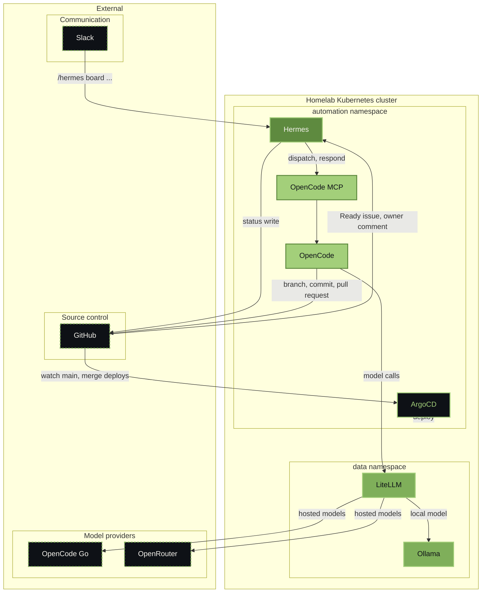
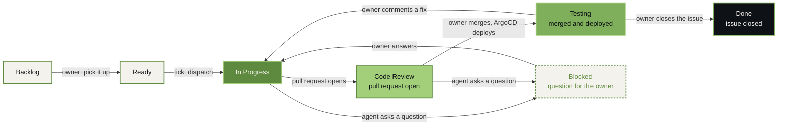

# Agentic code automation

One agent turns an issue into a reviewed pull request in any datahub-local
repository. The board carries the state, the issue carries the task, and the
owner keeps three steps: review the pull request, merge it, and test the change
once it is live.

  AI &amp; Agents
  Running, first cycle shipped
  <a class="meta-pill meta-pill--github" href="https://github.com/datahub-local/datahub-local-core">:fontawesome-brands-github: datahub-local-core</a>

<figure markdown="span">
  { width="1024" }
</figure>

## Problem

Fifteen repositories, one owner, and a steady supply of small changes. The work
between "this should be done" and "this is ready to review" is where it stalls:
read the issue, find the repository, cut the branch, keep the gate green, open a
pull request that explains itself, and keep the board honest about where the work
stands. Every step is small. Together they are the reason a two-line fix waits a
month.

A fixed pipeline does not cover it. The step that matters, deciding what to change
and how, needs reading and judgement, and a scheduled script cannot open a pull
request that a reviewer would accept.

## Approach

The loop splits judgement from state. The agent decides and writes code. Hermes,
the chat-driven agent in the `automation` namespace, owns every board write, so no
two components can disagree about where a task stands.

- **The board is the state.** Seven statuses on the GitHub Project, and each one is
  written by exactly one actor: `Backlog` by the issue creator, `Ready` by the
  owner, `In Progress`, `Blocked`, `Code Review` and `Testing` by Hermes, `Done`
  when the issue closes after the owner has verified the change.
- **The issue is the record.** `What`, `Why`, `Acceptance` and `Repo`, labelled
  `agent`. Moving it to `Ready` is the whole trigger: no assignment, no second
  signal.
- **A tick every ten minutes.** Hermes reads the board and starts a session on the
  lowest-numbered `Ready` issue, one at a time, and stops when the agent has no
  free turn. The dispatch waits up to two minutes, long enough to catch a question
  the agent asks before it starts editing. A session parked on a question does not
  hold the queue.
- **Only a trusted login reaches the agent.** The repositories are public, so the
  loop forwards a comment to the session only when a configured login wrote it.
  Anyone else's comment is named on the issue and never sent, which also means a
  stranger cannot answer a blocked card. GitHub additionally limits issue and pull
  request creation on these repositories to collaborators.
- **Every board write is announced.** A card added at `Backlog` or moved between
  statuses posts one line to Slack. The helper that writes the board posts the
  line itself, so a forgotten report cannot hide a move. Pull request and merge
  links stay in full on the issue, where GitHub sends its own notifications.
- **The agent works in the repository.** It claims the issue, cuts
  `type/<issue>-<topic>`, implements, runs that repository's gate, and opens one
  pull request with `Refs datahub-local/datahub-local#<n>`. When the change touches
  a documented capability it writes the OpenSpec delta on the same branch, so the
  pull request merges a spec that is already true.
- **A second model reviews the diff** before the handover, read-only, on a
  different model. Findings are fixed or answered, the gate runs again, and the
  review happens at most twice. That is the agent's own gate; the board's
  `Code Review` is where the owner first sees the pull request.
- **Questions come back to the owner.** The agent asks once with concrete options
  and stops. The question lands on the issue, the card moves to `Blocked`, and one
  line goes to Slack. Both the comment and the Slack line carry the OpenCode
  session link, so the owner can answer in writing or pick an option in the web
  UI. The answer, written on the issue or in the channel, arrives as the agent's
  next turn. An option picked in the web UI is written on the issue by the agent,
  because no tick sees that answer in time.
- **The owner merges.** Nothing merges automatically. The merge is also the
  deploy: ArgoCD reconciles `main`, and the tick moves the card to `Testing` when
  it sees the merge.
- **Testing is a real state.** The owner tries the live change and closes the
  issue once it works, which is when the card reaches `Done`. A comment on a
  `Testing` card moves it back to `In Progress`: the agent cuts a new branch from
  `main`, opens a new pull request, and the card goes through `Code Review` and
  back to `Testing` on merge. One pull request is open at a time, and every fix
  round leaves one comment on the issue with what changed and the gate result.
- **The board answers in Slack.** `/hermes board list`, `show`, `move` and
  `comment` run the same helper the tick uses, so a chat request reads and writes
  state without starting a turn.

## Architecture

Every box is a service. The outer group is the cluster, the inner groups are
namespaces, and the dashed boxes sit outside the homelab. LiteLLM is the single
exit for model calls, so the code turn can run on the local model or on a hosted
provider without changing anything above it.

## Workflow

The board is a state machine with four owner turns. Two of them are review and
testing, which the old `Testing` column used to share.

A card only leaves `Testing` in two ways: the owner closes the issue, or the
owner finds something to fix. The second is a new cycle, not an amendment, so the
agent starts from `main` and the loop runs again.

## Technologies

- **Hermes Agent** for dispatch, board writes, question handling, and the Slack
  front door, calling a model through the local LiteLLM gateway
- **OpenCode** behind an authenticated proxy for the code turn, reached through a
  seven-tool MCP shim
- **GitHub Apps**, one for the manager and one for the coder, with installation
  tokens minted by a sidecar on loopback instead of a personal token in the Pod
- **GitHub Projects** as the only state store, `agent` labels as the delegation
  switch
- **Slack** over Socket Mode, one slash command, private channel
- **OpenSpec** deltas carried inside the same pull request as the code
- Longhorn for the agent's home volume, gVisor for its pod

## Outcome

The first production cycle ran on 2026-11-02. Two issues were created, both were
dispatched by the loop, and both became pull requests: one straight through, one
that stopped to ask which of two page titles to use, went `Blocked`, took the
answer, resumed, and finished. No human touched a branch or a card.

Measured on that run: a tick with one dispatch took 59 seconds, a tick with a
dispatch plus a board transition 95 seconds, and the tick returns before the code
turn ends, so the ten-minute schedule never waits on a build. One turn at a time,
one checkout per repository, and three failed fixes end a turn as `BLOCKED`
instead of looping.

The limits are deliberate. The agent has no merge button and no board credential,
the manager owns every status write, and a missing tool or a permission it does not
hold is reported as a question rather than worked around.

## Further reading

- [Automation services](../services/automation.md): where the agent, its sidecars, and the tick live
- [Repositories](../repositories.md): which repository owns which part of the platform
- [`datahub-local-core`](https://github.com/datahub-local/datahub-local-core): the release, the board helper, and the skills the loop runs from
