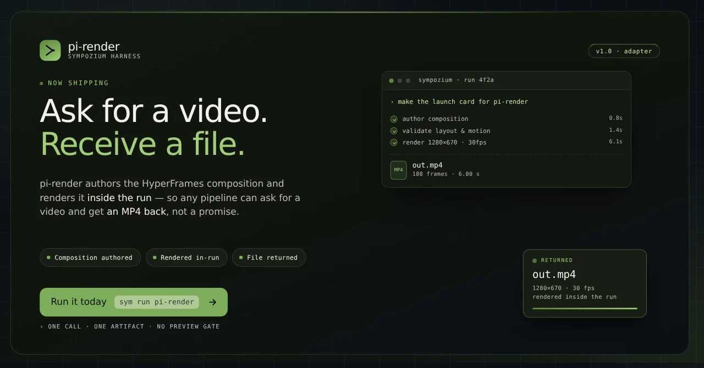

# n8n AI content engine

Versioned, LLM-powered workflows that draft content, generate diagrams, and turn
platform events into notifications, without a SaaS automation bill.

<p class="project-meta" markdown="span">
  <span class="meta-pill meta-pill--area">AI &amp; Agents</span>
  <span class="meta-pill meta-pill--status">Running</span>
  <a class="meta-pill meta-pill--github" href="https://github.com/datahub-local/datahub-local-workflows">:fontawesome-brands-github: datahub-local-workflows</a>
</p>

<figure markdown="span">
  { width="1024" }
</figure>

## Problem

Repetitive knowledge work is low-value in isolation and high-volume in
aggregate: summarising what changed, drafting a post about a release, turning a
description into a diagram, digesting a feed. Cloud automation tools solve it
but bill per task and hold the workflow definitions outside version control,
which is a poor fit for a platform that prides itself on owning its stack.

The goal was automation that is as reproducible as the rest of the platform.

## Approach

Workflows are treated as code. Their definitions live in a repository and deploy
through the same GitOps path as services.

- **n8n** hosts the workflows, with the main app, worker, webhook server, queue,
  and PostgreSQL metadata all run on the cluster rather than in a vendor account.
- **AI nodes** connect to cloud models, using the Gemini free tier with
  OpenRouter as budget-capped overflow for high-volume, low-sensitivity text.
- **Workflow definitions are versioned** in `datahub-local-workflows` and synced
  through Git, so a change is reviewed and reversible.
- Example workflows include **LinkedIn professional visibility** (drafting a
  post from a new release or docs change), **AI diagram generation** (turning a
  description or diff into a Mermaid diagram), news digesting, and document
  extraction.

## Technologies

- **n8n** with queue mode, workers, and PostgreSQL
- **Google Gemini** and **OpenRouter** through OpenAI-compatible endpoints
- **MCP** and **GitHub** events as triggers
- **datahub-local-workflows** for versioned definitions

## Authored video

Text and diagrams were the first outputs; video is the harder one, because the
artifact has to be a file rather than a promise. The `pi-render` harness in
`datahub-local-ai` runs a HyperFrames composition author inside the cluster: the
composer writes the composition from a brief, the engine lints and renders it, and
the caller fetches the result — one call, one artifact, no preview gate.

The card below is the artifact of one such run, authored and rendered in the
pipeline at 1280×670. Nothing in it is a template: the lockup, the chips and the
interface window are drawn from the brand tokens the brief carries.

<figure markdown="span">
  { width="1024" }
  <figcaption>A launch card authored inside the run: composition, render and returned file in one call</figcaption>
</figure>

## The article lane

Articles run through a second harness, `pi-writer` in `datahub-local-ai`, because
a long post is not one prompt: it needs research, a draft, a review and an edit,
and the research has to be verifiable afterwards. The adapter owns every model
turn and the workflow owns every count.

Two processes share one filesystem. The session server receives the request,
renders the prompt from its own files, and spawns the Pi agent as a child
process in a per-row directory. Pi reads the pages, writes the draft and a
ledger naming the page every fenced block came from, and answers on stdout.

```
n8n (900 s per turn)
  │ POST /v1/chat/completions  {task, brief, session_id, attempt, source_hosts}
  ▼
session-server.mjs  ── Node, one serialized queue per session
  │  1. resolveRunDir(workDir, session_id)   → /tmp/pi-writer/runs/article-<row>/
  │  2. articlePrompt(brief)                 → the adapter's own prompt files
  │  3. articleTurnInstruction({isIteration})→ "write" or "edit in place"
  │  4. fillSourceHosts(writing.md, hosts)   → sandbox map + citation allowlist
  ▼
spawn("pi", [...])   child process, cwd = the run directory
  │  reads $HOME/.pi/agent/{models.json, mcp.json, settings.json}
  ├──► LiteLLM gateway        (egress policy: the model namespace only)
  ├──► MCP servers on 8080    (egress policy: pods labelled mcpserver)
  │      firecrawl: search / scrape / map    github: read tools only
  └──► loopback proxy on 8081 (same process; no route out of the pod)
  │
  │  writes into cwd:  article.md, sources.json
  ▼ stdout (the draft, the verdict, the findings)
session-server.mjs
  │  5. splitArticle(stdout) → title + body
  │  6. revalidateLedger(...) → every cited page re-read, through Firecrawl
  │  7. serialiseLedger → sources.json rewritten
  ▼
response { article: {title, text, word_count, sources, quoted, dropped} }
```

The boundary that matters: **the model owns the prose and the files; the server
owns every fact about them.** Pi gets a prompt and a proxy and returns text; the
server decides the paths, reads the artifacts, re-reads the sources through the
one egress path the pod has, and counts the words. A fence whose page the server
cannot read again is rejected, so an invented command never reaches the publish
step.

## Outcome

The platform turns events into drafted, reviewable output automatically, with
the workflow logic owned and versioned alongside everything else. It also keeps
cloud spend predictable: cheap or free models do the bulk of the work, and the
overflow path has hard budget caps.

## Further reading

- [Automation services](../services/automation.md): n8n and the active workflows
- [AI & LLMs](../services/ai.md): the hybrid inference strategy
- [CI/CD](../services/cicd.md): how workflow changes are reviewed and delivered
