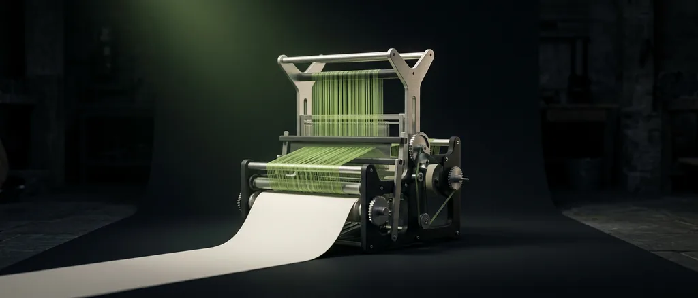
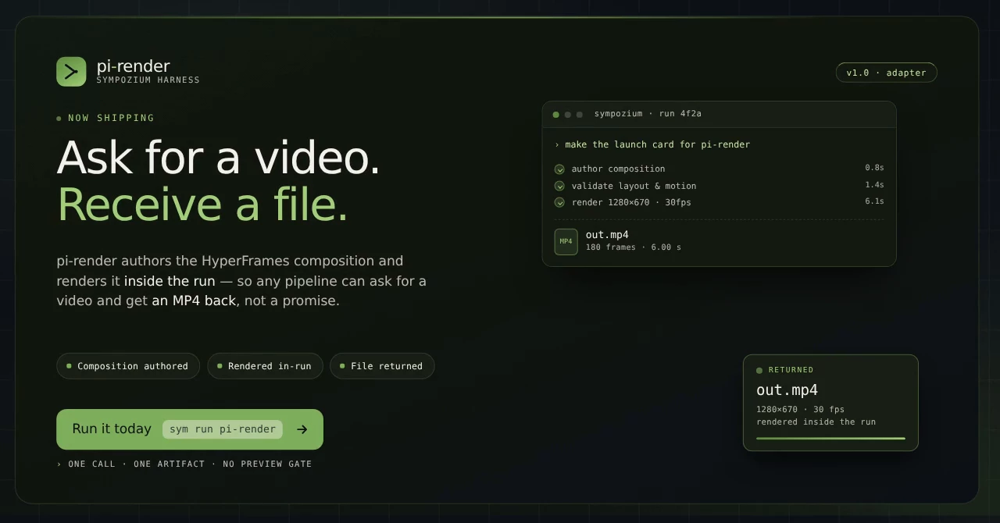

# n8n AI content engine

Versioned, LLM-powered workflows that draft content, generate diagrams, and turn
platform events into notifications, without a SaaS automation bill.

  AI &amp; Agents
  Running
  <a class="meta-pill meta-pill--github" href="https://github.com/datahub-local/datahub-local-workflows">:fontawesome-brands-github: datahub-local-workflows</a>

<figure markdown="span">
  { width="1024" }
</figure>

## Problem

Repetitive knowledge work is low-value in isolation and high-volume in
aggregate: summarising what changed, drafting a post about a release, turning a
description into a diagram, digesting a feed. Cloud automation tools solve it
but bill per task and hold the workflow definitions outside version control,
which is a poor fit for a platform that prides itself on owning its stack.

The goal was automation that is as reproducible as the rest of the platform.

## Approach

Workflows are treated as code. Their definitions live in a repository and deploy
through the same GitOps path as services.

- **n8n** hosts the workflows, with the main app, worker, webhook server, queue,
  and PostgreSQL metadata all run on the cluster rather than in a vendor account.
- **AI nodes** connect to cloud models, using the Gemini free tier with
  OpenRouter as budget-capped overflow for high-volume, low-sensitivity text.
- **Workflow definitions are versioned** in `datahub-local-workflows` and synced
  through Git, so a change is reviewed and reversible.
- Example workflows include **LinkedIn professional visibility** (drafting a
  post from a new release or docs change), **AI diagram generation** (turning a
  description or diff into a Mermaid diagram), news digesting, and document
  extraction.

## Technologies

- **n8n** with queue mode, workers, and PostgreSQL
- **Google Gemini** and **OpenRouter** through OpenAI-compatible endpoints
- **MCP** and **GitHub** events as triggers
- **datahub-local-workflows** for versioned definitions

## Authored video

Text and diagrams were the first outputs; video is the harder one, because the
artifact has to be a file rather than a promise. The `pi-render` harness in
`datahub-local-ai` runs a HyperFrames composition author inside the cluster: the
composer writes the composition from a brief, the engine lints and renders it, and
the caller fetches the result — one call, one artifact, no preview gate.

The card below is the artifact of one such run, authored and rendered in the
pipeline at 1280×670. Nothing in it is a template: the lockup, the chips and the
interface window are drawn from the brand tokens the brief carries.

<figure markdown="span">
  { width="1024" }
  <figcaption>A launch card authored inside the run: composition, render and returned file in one call</figcaption>
</figure>

## Outcome

The platform turns events into drafted, reviewable output automatically, with
the workflow logic owned and versioned alongside everything else. It also keeps
cloud spend predictable: cheap or free models do the bulk of the work, and the
overflow path has hard budget caps.

## Further reading

- [Automation services](../services/automation.md): n8n and the active workflows
- [AI & LLMs](../services/ai.md): the hybrid inference strategy
- [CI/CD](../services/cicd.md): how workflow changes are reviewed and delivered
